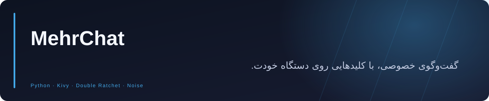
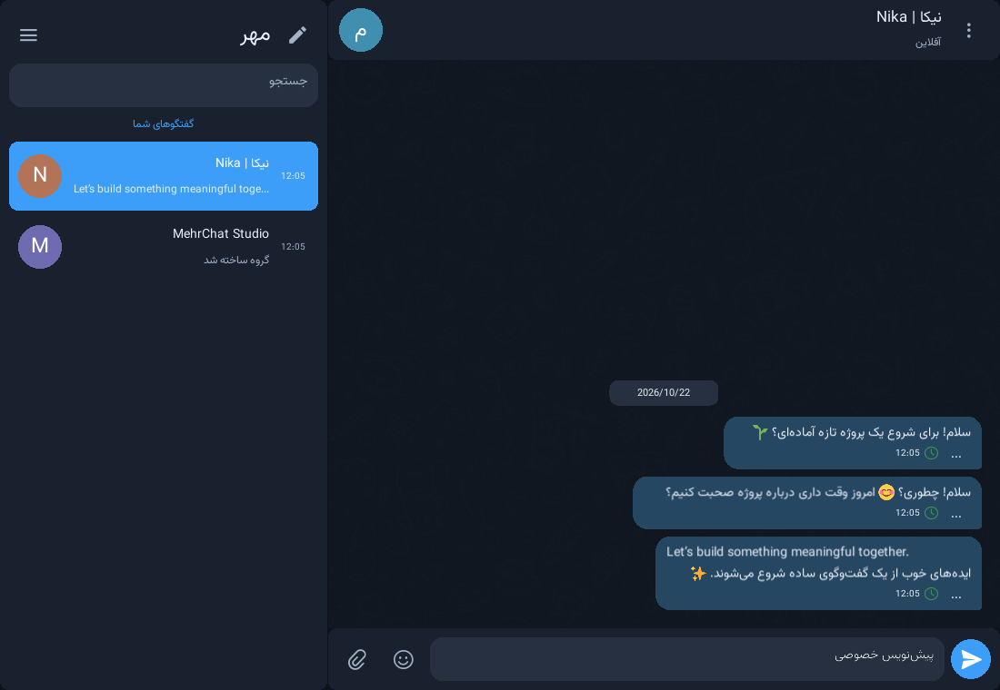
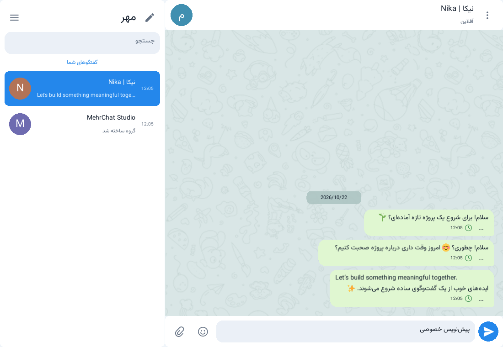

<div align="center">



**پیام‌رسان بومی و خودمیزبان با گفت‌وگو و گروه رمزگذاری‌شده، کلید هویت روی دستگاه، پشتیبان رمزگذاری‌شده و رابط فارسی و انگلیسی.**


<a href="https://github.com/Realjustawall/MehrChat/actions/workflows/build.yml"></a>

<a href="https://github.com/Realjustawall/MehrChat/releases/latest"></a>
<a href="docs/gallery.fa.md"></a>
<a href="#quick-start"></a>
<a href="https://github.com/Realjustawall/MehrChat/issues"></a>

[English](README.md) · [فارسی](README.fa.md)

</div>

---

[قابلیت‌های شاخص](#features) · [پیش‌نمایش](#preview) · [راه‌اندازی](#quick-start) · [توسعه](#development) · [مستندات](#documentation) · [امنیت و حریم خصوصی](#security) · [مجوز و بازخورد](#license)

<a id="features"></a>

## قابلیت‌های شاخص

| قابلیت | کاربرد |
|---|---|
| گفت‌وگوی خصوصی | پیام و گروه با رمزگذاری سرتاسری و کلید خصوصی هویت روی دستگاه کاربر. |
| مخاطبان | کارت هویت امضاشده، تبادل QR و شناسهٔ ۱۲ رقمی همراه کد عمومی پنج‌حرفی. |
| پیوست | انتقال رمزگذاری‌شده و پیش‌نمایش محدود تصویر، ویدیو و صدا در پردازش ایزوله. |
| حفظ هویت | خزانهٔ رمزگذاری‌شده، خروجی و بازیابی رمزگذاری‌شده، قفل حساب و نگهداری هویت. |
| رابط بومی | انتخاب زبان پیش از ورود، فونت وزیرمتن، ایموجی آفلاین و تم روشن و تیره. |
| خودمیزبانی | نصب تعاملی اوبونتو، TLS با اعتبارسنجی، هویت پین‌شدهٔ Noise و ساخت اختیاری کلاینت اختصاصی. |

<a id="preview"></a>

## پیش‌نمایش

رابط بومی لینوکس با حساب موقت رمزگذاری‌شده؛ تم روشن و تیره یک گفت‌وگو را نشان می‌دهند.



<details>
<summary>تصاویر بیشتر</summary>



</details>

[مشاهدهٔ گالری کامل](docs/gallery.fa.md)

<a id="quick-start"></a>

## راه‌اندازی

بستهٔ مناسب دستگاه را از ریلیز بگیرید و همهٔ فایل‌های اجرایی همراه را نگه دارید. رلهٔ قابل‌دسترسی را آماده کنید، پروفایل اتصال عمومی آن را از مسیر قابل‌اعتماد وارد کنید و هویت رمزگذاری‌شده بسازید یا بازیابی کنید.

نصب تعاملی رله روی اوبونتو:

```bash
git clone https://github.com/Realjustawall/MehrChat.git
cd MehrChat
git checkout v0.7.1
sudo bash deploy/install-ubuntu.sh
```

نصب‌کننده حساب مدیر، نشانی تأییدشده، TLS معتبر یا CA خصوصی، هویت پین‌شدهٔ Noise و کلاینت اختصاصی اختیاری را تنظیم می‌کند. پورت پیش‌فرض رله **8787/TCP** است. مدیریت روی **8788** فقط به loopback متصل است؛ برای مدیریت راه دور از تونل SSH استفاده کنید.

پیش از توزیع پروفایل اتصال، [راهنمای کامل استقرار و کلاینت](REFERENCE.md) را بخوانید. پیش از حذف برنامه، به‌ویژه در اندروید، پشتیبان رمزگذاری‌شدهٔ هویت را بیرون از فضای برنامه نگه دارید.

<a id="development"></a>

## توسعه

Python 3.12 و پیش‌نیازهای گرافیکی و رسانه‌ای سیستم‌عامل لازم‌اند.

```bash
python -m venv .venv
# Activate .venv for your shell before continuing.
python -m pip install -r requirements.txt
python main.py
```

دستورهای بررسی:

```bash
python -m unittest discover -s tests -v
```

<a id="documentation"></a>

## مستندات

- [مرجع کامل سرور و کلاینت](REFERENCE.md)
- [مدل تهدید و محدودیت‌ها](SECURITY.md)
- [مرجع قابلیت‌ها به فارسی](FEATURES.fa.md)
- [نصب‌کنندهٔ اوبونتو](deploy/install-ubuntu.sh)
- [منشأ وابستگی‌ها و دارایی‌ها](assets/licenses/INDEX.txt)

<a id="security"></a>

## امنیت و حریم خصوصی

رمزگذاری پیام، احراز هویت مسیر انتقال و ایزوله‌سازی فایل مرزهای جداگانه‌اند. اثرانگشت یا QR مخاطب را از مسیر قابل‌اعتماد بررسی و پشتیبان رمزگذاری‌شده را حفظ کنید. فرادادهٔ رله پنهان نمی‌شود و مسیر شبکهٔ قابل‌دسترسی همچنان لازم است. کد پنج‌حرفی، اطلاعات عمومی دعوت است و رمز عبور نیست. فایل اصلی رمزگذاری‌شده الزاماً بدون بدافزار نیست. مدل تهدید، محدودیت‌ها و ریسک‌های باقی‌مانده در [SECURITY.md](SECURITY.md) آمده است.

<a id="license"></a>

## مجوز و بازخورد

تحت مجوز [GPL-3.0](LICENSE) منتشر می‌شود.

اعلان‌های مجوز و انتساب آیکون و پس‌زمینهٔ برگرفته از Telegram Web A و گرافیک Twemoji در فایل‌های همراه حفظ شده‌اند.

[گزارش اشکال و پیشنهاد بهبود](https://github.com/Realjustawall/MehrChat/issues). نسخه، سیستم‌عامل و روش بازتولید را بنویسید و اطلاعات خصوصی یا رمزها را در گزارش قرار ندهید.

---

نگهداری توسط **[Realjustawall](https://github.com/Realjustawall)**.
