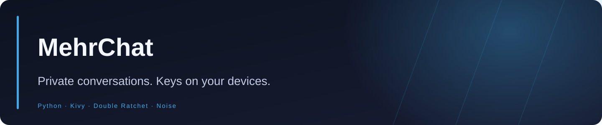
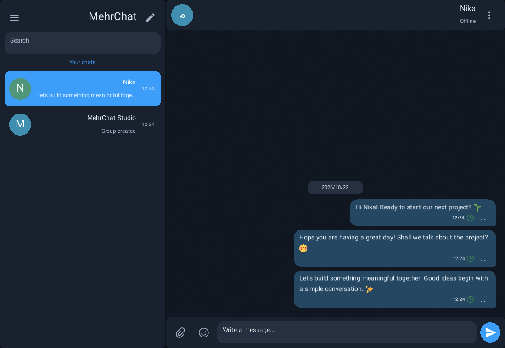
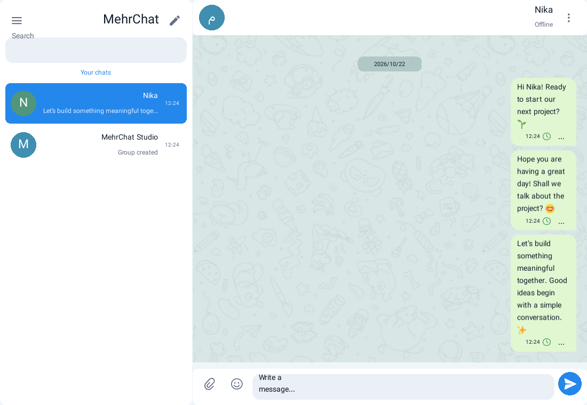

<div align="center">



**A self-hosted native messenger with encrypted conversations and groups, device-held identity keys, encrypted backups and Persian/English themes.**


<a href="https://github.com/Realjustawall/MehrChat/actions/workflows/build.yml"></a>

<a href="https://github.com/Realjustawall/MehrChat/releases/latest"></a>
<a href="docs/gallery.en.md"></a>
<a href="#quick-start"></a>
<a href="https://github.com/Realjustawall/MehrChat/issues"></a>

[English](README.md) · [فارسی](README.fa.md)

</div>

---

[Highlights](#features) · [Preview](#preview) · [Quick start](#quick-start) · [Development](#development) · [Documentation](#documentation) · [Security and privacy](#security) · [License and feedback](#license)

<a id="features"></a>

## Highlights

| Capability | What you get |
|---|---|
| Private conversations | End-to-end encrypted messages and groups with client-held private identity keys. |
| Contacts | Signed identity cards, QR exchange and a 12-digit ID plus a public 5-letter share code. |
| Attachments | Encrypted transfer and bounded image/video/audio previews using isolated workers. |
| Identity continuity | Encrypted vaults, encrypted export/restore, lock/unlock and retained identities. |
| Native interface | Persian/English selection before login, Vazirmatn typography, offline emoji and light/dark themes. |
| Self-hosting | Ubuntu setup wizard, verified TLS, pinned Noise identity and optional dedicated client builds. |

<a id="preview"></a>

## Preview

Native Linux UI with a temporary encrypted account. English captures contain English messages; theme variants show the same conversation.



<details>
<summary>More screens</summary>



</details>

[Open the full gallery](docs/gallery.en.md)

<a id="quick-start"></a>

## Quick start

Download the package for your device from Releases and keep all bundled runtime files. Set up a reachable relay, import its trusted public connection profile, then create or restore your encrypted identity.

For the interactive Ubuntu relay installer:

```bash
git clone https://github.com/Realjustawall/MehrChat.git
cd MehrChat
git checkout v0.7.1
sudo bash deploy/install-ubuntu.sh
```

The wizard configures the administrator, confirmed reachable address, verified TLS/private CA, pinned Noise identity and optional dedicated clients. Default relay TCP port: **8787**. Administration is loopback-only on **8788**; use an SSH tunnel for remote administration.

Follow the [complete deployment and client guide](REFERENCE.md) before distributing connection profiles. Back up your encrypted identity outside app storage before uninstalling, especially on Android.

<a id="development"></a>

## Development

Python 3.12 and the platform graphics/media prerequisites.

```bash
python -m venv .venv
# Activate .venv for your shell before continuing.
python -m pip install -r requirements.txt
python main.py
```

Validation commands:

```bash
python -m unittest discover -s tests -v
```

<a id="documentation"></a>

## Documentation

- [Complete deployment/client reference](REFERENCE.md)
- [Threat model and limitations](SECURITY.md)
- [Feature reference in Persian](FEATURES.fa.md)
- [Ubuntu installer](deploy/install-ubuntu.sh)
- [Dependency/asset provenance](assets/licenses/INDEX.txt)

<a id="security"></a>

## Security and privacy

Message encryption, transport authentication and file isolation are separate boundaries. Verify contact fingerprints/QR through a trusted channel and preserve encrypted backups. Relay metadata is not hidden; reachable networking is still required. The five-letter share code is public invitation data, not a password. Encrypted originals are not certified malware-free. See [SECURITY.md](SECURITY.md) for the threat model, limits and residual risks.

<a id="license"></a>

## License and feedback

Licensed under [GPL-3.0](LICENSE).

Telegram Web A derived icons/wallpaper and Twemoji graphics retain their bundled attribution and license notices.

[Report bugs or discuss improvements](https://github.com/Realjustawall/MehrChat/issues). Include your version, OS and reproducible steps; keep credentials and private data out of reports.

---

Maintained by **[Realjustawall](https://github.com/Realjustawall)**.
